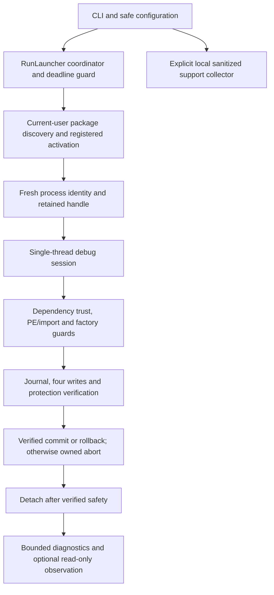

# WitcherFG technical behavior

WitcherFG attempts a temporary startup intervention for a single registered Xbox build. It uses the game's existing interposer and redirects four creation imports while the fresh owned target is stopped. It does not implement interpolation itself.

## Data flow and interfaces

`ILaunchEnvironment` supplies configuration, clock/guard, package/activation, process pin, memory, debugger, inventory, compatibility, observation, diagnostics and collector interfaces. `IMemory`/`IWritableMemory` separate inspection from writes. `IDebugBackend` owns native debug operations; `DebugSession` records safety/detach/termination evidence. `IRunGuard` bounds returned results and final output; unsafe terminal helper exit occurs before result formatting or timestamps.

## Compiled build record and exact mappings

| Guard | Required value |
| --- | --- |
| Package | `CDPROJEKTSA.Witcher3GOTY`, version `5.0.4.0` |
| Machine / PE identity | AMD64 `0x8664`, timestamp `0x6AC55CE6`, SizeOfImage `0x658F000` |
| Interposer | Version `2.14.1`, length `652928`, NVIDIA-valid signature and backing image matching the loaded module |
| Interposer SHA256 | `8c87c9499461da561edd529aa9bf7831d67d7b94ebb1c1a5ed54ef4934e1ea4c` |
| Fingerprint at RVA `0x1CB0384`, 32 bytes | `bea2f23fae85c0d5ae5a517bb573945525addd04bb52ce4ae239b7da944b7c09` |
| Fingerprint at RVA `0x1CB061D`, 32 bytes | `88f7cb6bdd8c6d3285de7ab6688c00d98d10d189e2906136aa8432b5afe3e736` |
| Factory guard | Manager pointer RVA `0x5A75F30`, member offset `0x302F568`; must be readable and null |

| Import | Native module | IAT RVA | Replacement |
| --- | --- | --- | --- |
| `D3D12CreateDevice` | `d3d12.dll` | `0x2B52450` | Matching export in verified `sl.interposer.dll` |
| `CreateDXGIFactory1` | `dxgi.dll` | `0x2B524D0` | Matching export in verified `sl.interposer.dll` |
| `CreateDXGIFactory2` | `dxgi.dll` | `0x2B524D8` | Matching export in verified `sl.interposer.dll` |
| `CreateDXGIFactory` | `dxgi.dll` | `0x2B524E0` | Matching export in verified `sl.interposer.dll` |

The source record is in [compatibility.cpp](../src/compatibility.cpp). Unknown executables, mixed/unexpected import routing, unresolved trust or conflicting local DLLs refuse before writes. A raw signed-game hash and game ACL changes are not required. The four-import intervention was sufficient in the local probe; the minimum necessary subset is not established.

## Ownership, mutation and deadlines

Registered activation uses the current user's validated package/AUMID. The observer starts before activation; existing sessions or multiple candidates refuse. Creation time, session, user, package and executable location identify the target. The retained process object prevents following a reused PID. All debugger operations occur on one thread for that target.

Inspection requests debugger exit policy FALSE. Before mutation the policy must become TRUE. The transaction journals original pointers/protections, validates memory and checks all four writes/read-backs/protection restorations before resuming. Verified commit or verified rollback allows policy FALSE and detach. Unverified restoration aborts only the fresh owned startup. Returned `StartupAborted` requires independently observed target exit; terminal helper death alone does not provide that evidence.

Mutation uses bounded preallocated deferred event records. No diagnostic/file/dependency work or growing C++ allocation is allowed during the unsafe interval. Unsafe session state goes straight to terminal helper exit. Native fixture tests independently observe target survival/death and sentinel preservation; their synthetic PE/dependency data cannot validate Witcher/NVIDIA compatibility.

Discovery has a monotonic 30-second deadline; total work through final reporting has 60 seconds plus at most two seconds cancellation cleanup. Post-detach observation has its own bounded duration. Registered activation/attach can lose the startup race; the factory guard still refuses. See [normal/forced exit boundaries](diagnostics.md) and [native fixture evidence](validation/windows-fixture-results.md).

## Configuration, diagnostics and restrictions

Schema 1 precedence is defaults → valid executable-relative TOML → verbosity override. File access captures fixed physical volumes, pins non-reparse directories, requires regular single-link files and uses same-session `Local\` mutexes. Existing retained mutex objects refuse, even abandoned ones. This does not promise cross-session mutual exclusion. [Configuration](configuration.md) records all defaults/ranges and storage costs.

The production SDK catalog is empty. The read-only provider can capture environment/dependencies/validated imports but cannot manufacture SDK activity or rejection meanings. FG and MFG, configured and active HAGS, and selected versus enumerated adapters remain distinct. [Diagnostics](diagnostics.md) defines availability and support collection limits.

There are no persistent game-file edits, service, automatic elevation, driver-profile changes, global logging-registry changes, remote SDK calls, product menu automation or telemetry. The SDK/game retain adapter selection and presentation lifecycle. For background integration documentation, see NVIDIA's [Streamline programming guide](https://github.com/NVIDIA-RTX/Streamline/blob/main/docs/ProgrammingGuide.md) and [manual hooking guide](https://github.com/NVIDIA-RTX/Streamline/blob/main/docs/ProgrammingGuideManualHooking.md).
